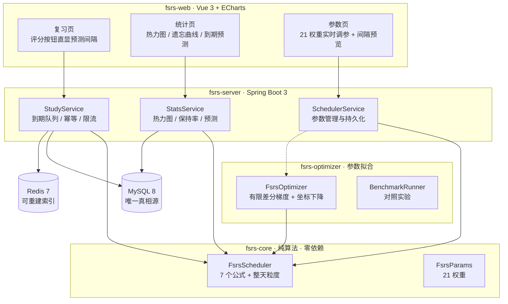

# fsrs-engine

**基于 FSRS-6 记忆算法的个性化复习调度引擎**，包含自研的 Java 参数优化器。

> FSRS（Free Spaced Repetition Scheduler）是目前公开的间隔重复算法里预测精度最高的一个，Anki 已内置。官方 Java 库只实现了算法本身——**没有参数优化、没有持久化、没有调度队列，并且被限制为 UTC-only**。本项目补上了这些，其中「用复习历史拟合 21 个个性化参数」在 Java 生态里此前是空缺。

技术栈：**Java 21 · Spring Boot 3 · MySQL 8 · Redis 7 · Vue 3 · ECharts**

---

## 一、它解决什么问题

间隔重复类应用的调度质量取决于两件事：**算法**和**参数**。

- 算法决定「稳定性 S 和难度 D 如何随每次评分演化」。
- 参数（21 个权重）决定「这套演化规则有多贴合**你**」。默认参数是一组人群平均意义上的经验值；同一个学习者用自己几百条复习记录拟合出的参数，预测误差会显著下降。

Anki 桌面端能做参数优化，靠的是 Rust/Python 实现。**Java 侧只有算法库**——本项目把这个缺口补上了，并且是可以在后端服务里在线跑的。

---

## 二、架构



模块依赖方向是单向的：`web → server → core`，`optimizer → core`。`core` 与 `optimizer` 都不依赖任何框架，可以独立当库使用。

---

## 三、模块

| 模块 | 说明 |
|---|---|
| [`fsrs-core`](fsrs-core/README.md) | FSRS-6 七个公式的纯 Java 实现，47 个测试全绿，含对官方 `java-fsrs` 库的**逐值对拍** |
| `fsrs-optimizer` | 从复习历史拟合 21 个权重；官方 Java 库缺失的能力 |
| `fsrs-server` | Spring Boot 服务：到期队列、幂等提交、统计聚合、参数管理 |
| `fsrs-web` | Vue 3 前端：可交互复习、热力图、遗忘曲线调参、到期预测 |

算法细节、公式推导与对拍结果见 **[fsrs-core/README.md](fsrs-core/README.md)**。

---

## 四、两个值得讲的设计点

### 1. MySQL 是唯一真相源，Redis 只是可重建的索引

复习提交时**先写 MySQL 事务，成功后再更新 Redis**。Redis 更新失败不回滚 MySQL——因为 Redis 里的东西全部可以重建（`rebuildDueQueue(userId)`）。

这样做的取舍是明确的：放弃「Redis 与 MySQL 强一致」这个做不到的目标，换成「最终一致 + 可重建」。代价是极短时间内队列可能不准，收益是绝不需要分布式事务，也不会因为一次 Redis 抖动丢数据。

| Key | 结构 | 用途 |
|---|---|---|
| `srs:due:{userId}` | ZSet（score=due_ts） | 到期队列，`ZRANGEBYSCORE` 取今天该复习的 |
| `srs:new:{userId}` | String | 每日新卡配额，`EXPIREAT` 到用户时区次日 0 点 |
| `srs:state:{cardId}` | Hash | 调度状态缓存，TTL 带随机抖动防雪崩 |
| `srs:idem:{clientReviewId}` | SETNX | 提交幂等 |
| `srs:session:{userId}` | Set | 本轮已发放的卡 |

Lua 脚本负责原子性：`acquire_cards.lua` 一次性从队列取 N 张并写入 session 集合，避免两个并发请求拿到同一张卡。

**为什么不用分布式锁**：单实例部署下没有跨节点竞争，引入 Redisson 只是增加故障面。这个判断本身比"上了分布式锁"更有价值。

### 2. 遗忘曲线是连续的，调度按整天

`R(t, S) = (1 + factor · t / S)^(-w20)` 是连续函数——前端画曲线、优化器算梯度都需要它。

但调度按整天算：0.9 天后复习算"同一天"，走 FSRS-6 的同日公式；1.9 天后按 1 天算。这与官方参考实现一致，也是真实产品里的行为。

---

## 五、快速开始

### 依赖

- JDK 21
- MySQL 8（默认 `localhost:3306`，用户 `root`）
- Redis（默认 `127.0.0.1:6379`）

> Windows 上没有官方 Redis 构建。`tools/redis-server.exe` 是从 `tools/embedded-redis-1.4.4.jar` 里提取的 Windows 版（Redis 5.0.14.1），`tools/start-redis.ps1` 直接使用它；保留那个 jar 是为了这个二进制可追溯、可重新提取。

### 启动

```powershell
# 一键启动：Redis + 后端 + 前端（推荐）
powershell -ExecutionPolicy Bypass -File .\start-all.ps1
#   前端 http://localhost:5173   演示账号 demo / demo1234

# --- 手动分步（一键脚本出问题时）---

# 1. 算法模块测试（不需要任何外部服务）
mvn -pl fsrs-core test

# 2. 启动 Redis（项目自带 Windows 二进制；6379 已在监听会自动复用）
powershell -ExecutionPolicy Bypass -File tools\start-redis.ps1

# 3. 启动后端。必须从聚合根用 -pl ... -am 构建：
#    fsrs-core 是同一个 reactor 里的兄弟模块，没有发布到任何仓库，
#    单独构建 fsrs-server 会报 "The POM for com.fsrs:fsrs-core is missing"。
mvn -f pom.xml -pl fsrs-server -am package -DskipTests
& "$env:JAVA_HOME\bin\java.exe" -jar fsrs-server\target\fsrs-server-1.0.0.jar
#   接口地址 http://localhost:8080
#   用 JAVA_HOME 下的 java：PATH 上的 java 可能是 Oracle 的 javapath 跳转壳，
#   它会静默失败（不输出任何内容就退出）。

# 4. 启动前端
cd fsrs-web; npm install; npm run dev
#   打开 http://localhost:5173   演示账号 demo / demo1234
```

数据库连接、Redis 地址、端口都在 `fsrs-server/src/main/resources/application.yml` 里。

### 配置说明

`fsrs-server` 默认连接本地 MySQL（`root` / `123456`）与 Redis。生产部署时改环境变量即可，不要把凭据写进代码。

---

## 六、验证状态

下面每一项都是在本机**实际跑出来的**，不是"应该能通过"。

| 项 | 结果 |
|---|---|
| `fsrs-core` 单元测试 | **47 / 47 通过**（40 个行为测试 + 7 个对拍测试） |
| 与官方 `java-fsrs` 对拍 | **240 组状态转换 × 3 个量**（stability / difficulty / interval）全部一致，容差 **1e-9**；另加 9 步连续复习序列、首次复习 4 种评分、遗忘曲线 5×6 组 |
| 对拍发现的实现缺陷 | **3 处**（详见 [fsrs-core/README.md](fsrs-core/README.md) 第四节） |
| `fsrs-optimizer` 测试 | **8 / 8 通过** |
| 优化器性能 | 10 万条复习记录拟合 **8.1 秒**（上限 60 秒） |
| 参数拟合效果 | 从大错起点拟合：log loss `0.5715 → 0.4930`（**↓13.7%**），收敛到"用真权重算出的理论下限"的 **1.02%** 以内 |
| 复习效率 | 同等预测保持率（0.8126 vs 0.8124）下，个性化参数所需复习次数比默认参数 **减少 22.4%** |
| 全量构建 | `mvn test` 三个模块 **BUILD SUCCESS** |
| 端到端链路 | 登录 → 建卡组 → 建卡 → 取队列（含 `predictedIntervals`）→ 提交复习 → **幂等重放** → 统计 / 热力图 / 遗忘曲线 / 路线图，全部通过，服务端日志零 ERROR |
| **并发幂等（200 并发）** | 同一 `clientReviewId` 并发 200 次：`review_log` **只增 1 条**、`duplicate=false` 恰好 1 个、其余 **199 个命中幂等**、所有响应 `nextDue` 一致、**重复计分 0 次** |
| **无丢失更新（200 并发）** | 同一张卡 200 个不同幂等键并发：**200 个请求全部成功且 `review_log` 恰好增 200 条** |
| 吞吐 | 200 并发不同卡片：**275.5 req/s**（墙钟 0.73 秒；p50 519.9ms / p99 1142.6ms） |
| 前端构建 | `npm run build` **exit code 0**，`vue-tsc` 零错误，2284 个模块，产物 gzip **0.66 MB** |

复现方式：

```bash
# 算法与对拍
mvn -pl fsrs-core test

# 优化器（含 10 万条性能测试）
mvn -pl fsrs-optimizer test

# 并发幂等压测（需要服务已在 8080 运行；Windows 上首次运行需绕过执行策略）
powershell -ExecutionPolicy Bypass -File benchmarks/idempotency-stress.ps1 -Concurrency 200
```

> 并发数字有一个前提值得说明：压测把限流上限放开了（`--fsrs.redis.ratelimit.max-requests=1000000`），否则默认的 300 次/分钟会先把请求拒掉。这本身也验证了限流器在工作。


---

## 七、已知限制

- **fuzzing 是简化实现**：官方用三个区间分档 + 固定种子，本项目用统一 ±5%。fuzzing 属于调度体验优化，不参与对拍。
- **前端有一个受限环境兼容垫片**：`fsrs-web/scripts/esbuild-loader.cjs`。Vite 依赖 esbuild，而 esbuild 的 npm 包固定用**子进程 + 管道**通信；某些受限环境（拒绝带管道的 `spawn`，报 `EPERM`）会导致构建在读取任何模块前就失败。这个垫片优先走原生 esbuild，**只在观察到 spawn 失败时才降级**到同线程的 `esbuild-wasm` 实现，因此在正常机器上它只是透明转发、行为与不存在时一致。它不是项目功能，属于环境适配。
- **`/api/study/queue` 的 `totalDue` / `totalNew` 口径**：这两个计数只统计"此刻已到期/未学"的卡，而返回的卡片列表在指定卡组时可能包含更多；前端进度条应以返回列表长度为准。
- **不做 Anki 兼容**：不支持导入导出 `.apkg`、音频/图片、共享牌组、多端同步。
- **单实例部署**：没有做多节点下的队列竞争处理，因为本项目面向单机运行。
- **优化器是复现 + 工程化**，不是新算法研究。它的价值在于「Java 生态第一个可用实现」，以及能在服务端对真实复习数据跑拟合。
- **固定间隔策略的可比性**：`BenchmarkRunner` 的 `fixed-1-3-7-15-30` 是按重放历史评分计数的，早期密集复习会"蹭"到本在别的间隔下产生的评分，因此它的保持率与其他两条线不可比。真正严格的"同保持率下复习次数"需要闭环模拟器按已知真权重重新生成结果。


---

## 八、目录结构

```
fsrs-engine/
├── pom.xml                  # Maven 多模块
├── fsrs-core/               # 算法（无框架依赖）
│   └── README.md            # 公式、语义、对拍报告
├── fsrs-optimizer/          # 参数优化器 + 对照实验
├── fsrs-server/             # Spring Boot 服务
│   └── src/main/resources/
│       ├── db/schema.sql    # 建表
│       └── lua/             # Redis 原子脚本
├── fsrs-web/                # Vue 3 + ECharts
├── tools/                   # Redis 启停脚本、压测脚本
└── docs/                    # 架构与实验报告
```
